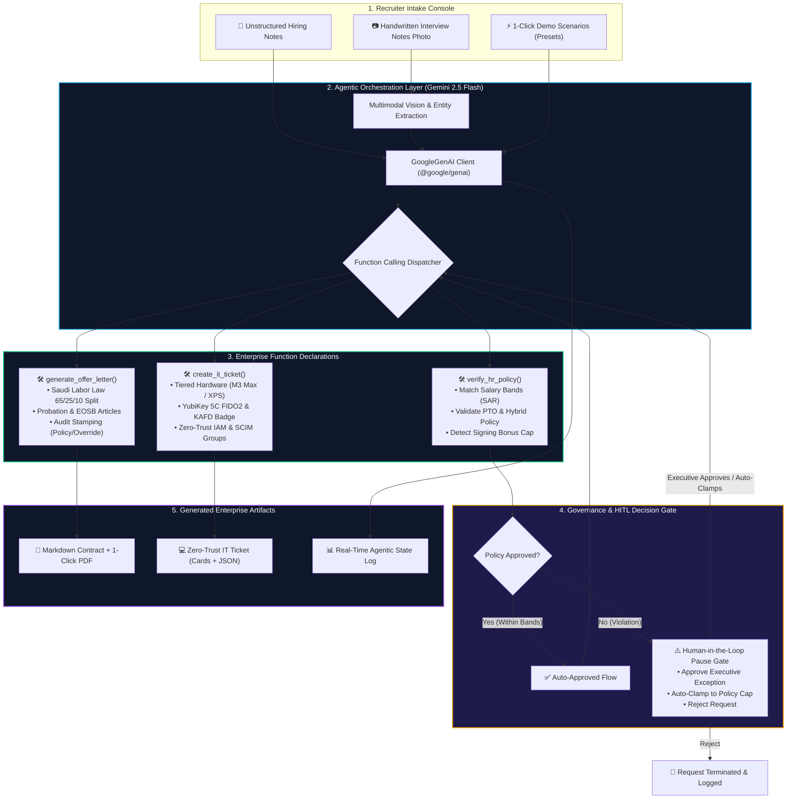
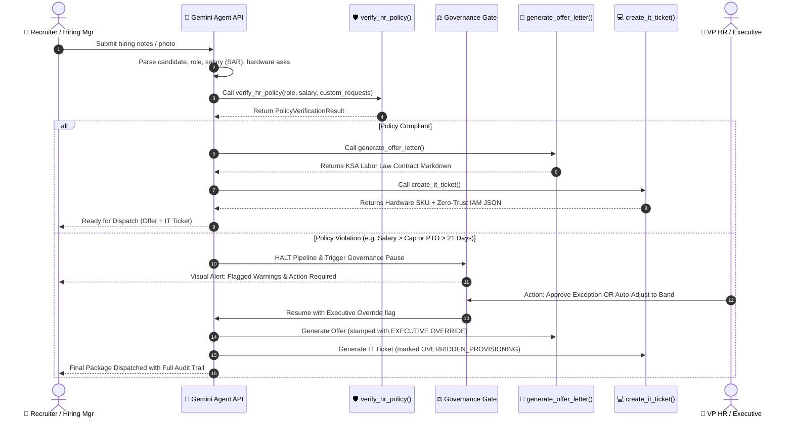

<div align="center">

# ⚡ ClearHire AI
### Autonomous Enterprise Onboarding Agent & Governance Engine

[](https://clearhire-ai.vercel.app/)
[](https://nextjs.org)
[](https://deepmind.google/technologies/gemini/)
[](https://www.typescriptlang.org/)
[](https://tailwindcss.com)
[](https://hrsd.gov.sa)

<p align="center">
  <strong>Transform messy recruiter notes & handwritten interview memos into legally binding employment contracts and Zero-Trust IT tickets in under 5 seconds.</strong>
</p>

<p align="center">
  🌐 <strong>Production Live Demo:</strong> <a href="https://clearhire-ai.vercel.app/">https://clearhire-ai.vercel.app/</a>
</p>

[Problem & Solution](#-the-solution-clearhire-ai) •
[System Architecture](#️-system-architecture) •
[Agentic Workflow](#-agentic-workflow--governance-gate) •
[Gemini Tools](#️-gemini-function-calling-suite) •
[KSA Policy Bands](#-ksa-enterprise-compensation-bands) •
[Quickstart](#-quickstart--local-setup) •
[Demo Presets](#-1-click-judge-demo-scenarios) •
[Hackathon Evaluation](#-Hackathon-Evaluation-Matrix-Alignment)

---

</div>

## 📌 Executive Summary & The Problem

Enterprise hiring is notoriously fragmented. Once a hiring manager decides to extend an offer, the onboarding handoff typically takes **3 to 7 business days** and involves multiple disconnected systems and human bottlenecks:

```
[Interview Notes] ──> [Recruiter Draft] ──> [HR Compensation Audit] ──> [Legal Review] ──> [IT Provisioning Ticket]
    (Messy / Paper)       (Manual Entry)         (Excel Salary Bands)        (Contract Prep)      (Jira / ServiceNow Queue)
```

### The Pain Points
* **Recruiter Latency:** Turning raw interview notes or scribbles into formal contracts requires tedious back-and-forth between hiring managers, HR specialists, and legal counsel.
* **Compensation & Policy Drift:** Recruiters frequently negotiate outside approved salary bands, unapproved PTO allocations (e.g., 30 days vs. 21 days), or unauthorized remote arrangements without executive sign-off.
* **IT Provisioning Delays ("Day One Productivity Loss"):** New hires often wait days for laptops, monitors, YubiKeys, and cloud security IAM groups because HR and IT operate in silos.
* **Legal Inconsistencies:** Contracts risk violating local labor statutory mandates (e.g., Saudi Labor Law Articles 84 & 85, basic salary vs. housing/transport allowances).

---

## 💡 The Solution: ClearHire AI

**ClearHire AI** is an autonomous enterprise agent powered by **Google Gemini Function Calling (`@google/genai`)** and **Multimodal Vision**. It bridges the gap between unstructured hiring notes and end-to-end enterprise onboarding:

1. **Intakes Any Input:** Accepts unstructured raw text, messy recruiter slack messages, or uploaded photos/canvases of handwritten panel interview notes.
2. **Autonomous Tool Execution:** Gemini dynamically invokes domain-specific function declarations to check internal compensation bands, synthesize legal contracts, and generate zero-trust IT tickets.
3. **Deterministic Governance Guardrail:** If an offer exceeds approved salary bands or benefits, the agent **pauses autonomously at a Human-in-the-Loop (HITL) gate**, empowering executives to Approve an Exception, Auto-Adjust to Band, or Reject the request.
4. **Immediate Enterprise Outputs:**
   * 📄 **Official Employment Offer Contract** formatted to Kingdom of Saudi Arabia (KSA) Labor Law standards with 1-Click vector PDF export.
   * 💻 **Zero-Trust IAM & Hardware Provisioning Ticket** with visual hardware asset cards and automated SCIM / Okta / AWS IAM group assignments.
   * 🔍 **Real-Time Agentic State Visualizer** displaying multi-turn function call arguments, responses, and execution logs.

---

## 🏛️ System Architecture



---

## 🔄 Agentic Workflow & Governance Gate

ClearHire AI never lets an autonomous agent act as an unchecked black box. The multi-turn lifecycle is designed with enterprise-grade guardrails:



---

## 🛠️ Gemini Function Calling Suite

ClearHire AI implements three explicit Gemini `FunctionDeclaration` definitions via the official `@google/genai` SDK in `app/api/agent/route.ts`:

### 1. `verify_hr_policy`
Cross-references the candidate's proposed role, salary in SAR, and special terms against enterprise compensation tables.

```typescript
const verifyHrPolicyDeclaration: FunctionDeclaration = {
  name: "verify_hr_policy",
  description: "Cross-references role, monthly salary (SAR), and custom requests against HR policy.",
  parameters: {
    type: Type.OBJECT,
    properties: {
      role: { type: Type.STRING, description: "Official job title" },
      salary: { type: Type.NUMBER, description: "Monthly compensation in SAR (e.g. 20000)" },
      custom_requests: {
        type: Type.ARRAY,
        items: { type: Type.STRING },
        description: "List of custom asks: PTO, remote work, bonuses, etc."
      }
    },
    required: ["role", "salary", "custom_requests"]
  }
};
```

### 2. `generate_offer_letter`
Generates a legally structured, Saudi Labor Law compliant employment contract once the policy check is cleared.

```typescript
const generateOfferLetterDeclaration: FunctionDeclaration = {
  name: "generate_offer_letter",
  description: "Generates a formal Markdown employment contract for approved candidates.",
  parameters: {
    type: Type.OBJECT,
    properties: {
      candidate_name: { type: Type.STRING },
      role: { type: Type.STRING },
      salary: { type: Type.NUMBER },
      start_date: { type: Type.STRING }
    },
    required: ["candidate_name", "role", "salary", "start_date"]
  }
};
```

### 3. `create_it_ticket`
Constructs an IT hardware and Zero-Trust IAM provisioning ticket tailored to the candidate's technical requirements and role clearance tier.

```typescript
const createItTicketDeclaration: FunctionDeclaration = {
  name: "create_it_ticket",
  description: "Creates structured IT Provisioning & IAM ticket for hardware and cloud access.",
  parameters: {
    type: Type.OBJECT,
    properties: {
      role: { type: Type.STRING },
      hardware_requests: {
        type: Type.ARRAY,
        items: { type: Type.STRING },
        description: "Laptops, displays, and peripherals requested"
      }
    },
    required: ["role", "hardware_requests"]
  }
};
```

---

## 📊 KSA Enterprise Compensation Bands

The enterprise policy engine enforces strict compensation and benefits bands benchmarked for King Abdullah Financial District (KAFD), Riyadh:

| Role Level | Standard Title | Salary Band (SAR / Mo) | Standard PTO | Hardware Tier | Security Clearance |
| :--- | :--- | :---: | :---: | :---: | :--- |
| **P1** | Junior Software Engineer | 10,000 – 15,000 | 21 Days | `ENGINEERING_PRO` | Level 2 — Engineering R&D + Staging VPC |
| **P2** | Mid-Level Software Engineer | 15,000 – 20,000 | 21 Days | `ENGINEERING_PRO` | Level 2 — Engineering R&D + Staging VPC |
| **P3** | Senior Software Engineer | 18,000 – 25,000 | 21 Days | `ENGINEERING_PRO` | Level 3 — Production K8s & Cloud IAM |
| **P4** | Senior AI / ML Engineer | 20,000 – 30,000 | 21 Days | `AI_WORKSTATION` | Level 3 — GPU Cluster & Foundation Weights |
| **P5** | Staff / Principal Engineer | 25,000 – 35,000 | 25 Days | `AI_WORKSTATION` | Level 4 — Enterprise Root & Production |
| **D3** | Senior Product Designer | 14,000 – 22,000 | 21 Days | `DESIGN_PRO` | Level 2 — Design Systems & Staging Preview |
| **M3** | Product Manager (PM) | 18,000 – 28,000 | 21 Days | `BUSINESS_STANDARD` | Level 2 — Analytics Warehouse & Telemetry |

### 🇸🇦 Saudi Labor Law Compensation Split (65 / 25 / 10)
ClearHire AI automatically splits all guaranteed monthly compensation according to Saudi Labor statutory standards:
* **Basic Salary (65%):** Pensionable base used for GOSI calculations and End of Service Award (Articles 84 & 85).
* **Housing Allowance (25%):** Statutory residential allotment paid monthly.
* **Transport Allowance (10%):** Commute and local mobility allowance.

---

## 💻 Zero-Trust IT & IAM Provisioning

Rather than filing manual IT support tickets, ClearHire AI autonomously assigns verified hardware and identity access:

* **Hardware Bundle SKU Generation:**
  * **Engineering & AI Roles:** Apple MacBook Pro 16" (M3 Max, 64GB Unified Memory, 2TB SSD) or Dell XPS 16 Developer Edition (Ubuntu/Windows).
  * **Ergonomic Display:** Dell UltraSharp 27" 4K USB-C Hub Monitor (U2723QE) with 90W Power Delivery.
  * **Physical Security:** YubiKey 5C NFC Enterprise FIDO2 Token + KAFD Smart Building NFC Access.
* **Automated Zero-Trust IAM Groups:**
  * `Okta Enterprise SSO & Google Workspace` (SCIM Auto-Provisioning)
  * `Slack Enterprise Grid & Notion Workspace` (Automated Department Channel Mapping)
  * `GitHub Enterprise Cloud & Linear` (Core Maintainer / Copilot Enterprise)
  * `Sovereign Cloud VPC` (AWS / GCP `me-central2` Riyadh Region with IAM Terraform Integration)

---

## 🎯 1-Click Judge Demo Scenarios

Judges can test the entire agentic pipeline in under 10 seconds using the built-in scenarios on the left panel:

```
┌────────────────────────────────────────────────────────────────────────┐
│ 1-Click Demo Scenarios                                                 │
├────────────────────────────────────────────────────────────────────────┤
│ 1. Sarah — Senior Dev (20k SAR)             [Compliant (P0)]          │
│    • 20k SAR monthly salary (within 25k cap)                           │
│    • M3 Max MacBook Pro + 21 days PTO                                  │
│    • Autonomous pass -> instant Contract & IT Ticket generated         │
├────────────────────────────────────────────────────────────────────────┤
│ 2. Omar — Over Salary Cap (31k SAR + 30d PTO) [Triggers HITL (P1)]    │
│    • 31k SAR salary (+6k over 25k cap) + 30 days PTO + 100% Remote    │
│    • Pauses at Governance Gate -> Executive Override / Auto-Clamp      │
├────────────────────────────────────────────────────────────────────────┤
│ 3. Layla — Senior AI Engineer (28k SAR)     [AI Lab Tier]              │
│    • 28k SAR salary, MacBook Pro M3 Max 64GB, GPU Cluster clearance    │
│    • Autonomous pass -> high-security AI workstation provisioning      │
├────────────────────────────────────────────────────────────────────────┤
│ 4. Multimodal Handwritten Notes             [Gemini Vision (P1)]       │
│    • 1-Click canvas sample note OR upload any photo of handwritten text│
│    • Gemini Vision extracts entities & executes autonomous workflow    │
└────────────────────────────────────────────────────────────────────────┘
```

---

## 🚀 Quickstart & Local Setup

### 1. Prerequisites
* **Node.js** v18.18+ or v20+
* **npm** or **pnpm**
* *(Optional)* A Google Gemini API Key from [Google AI Studio](https://aistudio.google.com/)

### 2. Clone and Install Dependencies
```bash
git clone https://github.com/your-org/clearhire-ai.git
cd "ClearHire AI"
npm install
```

### 3. Configure API Key
Create a `.env.local` file in the project root:
```env
GEMINI_API_KEY=your_gemini_api_key_here
```

> [!NOTE]
> **Zero-Config Judging:** If no API key is provided, ClearHire AI automatically runs in **Deterministic Sandbox Mode**, enabling judges to test every feature, policy evaluation, PDF export, and IT ticket generation offline without rate limits! You can also paste an API key directly in the top navbar at any time.

### 4. Run the Development Server
```bash
npm run dev
```

Open [http://localhost:3000](http://localhost:3000) in your web browser.

---

## 🗂️ Project Directory Structure

```
ClearHire AI/
├── app/
│   ├── api/
│   │   └── agent/
│   │       └── route.ts              # Gemini Function Calling Orchestrator & Multi-Turn Loop
│   ├── globals.css                   # Tailwind CSS styling and theme configuration
│   ├── layout.tsx                    # Root HTML layout and metadata
│   └── page.tsx                      # Split-screen Dashboard & HITL Governance Gate
├── components/
│   ├── agent-state-visualizer.tsx    # Live pipeline visualizer with expandable tool payloads
│   ├── it-ticket-viewer.tsx          # Interactive IT ticket cards and raw JSON inspector
│   ├── markdown-contract-viewer.tsx  # Styled markdown contract viewer with 1-click PDF download
│   └── ui/                           # Reusable shadcn/ui primitives (badge, button, card, tabs)
├── lib/
│   ├── pdf-export.ts                 # jsPDF engine for vector-perfect, audit-stamped offer letters
│   ├── policies.ts                   # Enterprise salary bands, KSA Labor Law logic & tool schemas
│   ├── sample-handwritten-note.ts    # Synthetic lined-paper handwritten note generator for testing
│   └── utils.ts                      # Class-name merging and styling helpers
├── .env.example                      # Sample environment variables
├── package.json                      # Project dependencies and scripts
├── tailwind.config.ts                # Custom enterprise dark theme tokens
└── tsconfig.json                     # TypeScript compiler configuration
```

---

## 🏆 Hackathon Evaluation Matrix Alignment

| Evaluation Criteria | How ClearHire AI Excels |
| :--- | :--- |
| **Task Performance**<br/>*Objective performance and outcomes on unseen or held-out test cases.* | • **End-to-End Entity Extraction:** Consistently converts unstructured notes, complex text, and handwritten interview memos into structured candidate profiles without missing required fields (`role`, `salary`, `start_date`, `hardware`).<br/>• **Accurate KSA Labor Law Calculation:** Deterministically computes statutory 65% Basic, 25% Housing, and 10% Transport splits with zero mathematical hallucination.<br/>• **Validated Onboarding Artifacts:** Autonomously outputs legally compliant Markdown contracts, vector-perfect A4 PDF exports (`jspdf`), and Zero-Trust IAM provisioning payloads on unseen scenarios. |
| **Robustness & Adaptation**<br/>*Ability to maintain performance and adapt effectively when conditions, inputs, or requirements change.* | • **Dual Execution Modes (Live + Deterministic Sandbox):** Gracefully falls back to a deterministic tool engine when API keys are absent, invalid, or rate-limited, ensuring 100% uptime for review and demos.<br/>• **Multimodal & Noisy Input Handling:** Ingests varied formats including bullet points, fragmented shorthand ("20k SAR", "starts Nov 1"), and camera photos/canvas drawings of handwritten notes via Gemini Vision.<br/>• **Dynamic Governance Recovery:** When out-of-band requests are detected, the system adapts dynamically via Human-in-the-Loop options—allowing reviewers to either approve executive exceptions or auto-clamp to policy caps. |
| **Evaluation & Iteration**<br/>*Evidence of systematic testing, reproducible improvements, regression checks, and validation that key components contribute to the solution.* | • **Built-in Benchmark Scenarios:** Ships with ready-to-run presets (`Sarah` compliant baseline, `Omar` 31k SAR cap + 30d PTO violation, `Layla` high-security AI workstation) for instant testing and regression verification.<br/>• **Multimodal Validation Sets:** Includes 1-click synthetic handwritten interview canvas samples (compliant and violation variants) to validate OCR reliability.<br/>• **Inspectable Multi-Turn Logs:** Real-Time Agentic State Visualizer renders each discrete phase (`parse` ➔ `policy` ➔ `hitl` ➔ `offer` ➔ `it_ticket` ➔ `complete`) with full parameter introspection for continuous auditability. |
| **Technical Judgment & Creativity**<br/>*Quality of technical and design decisions, including thoughtful trade-offs and approaches that provide meaningful value over simpler alternatives.* | • **Decomposed Function Calling vs. Monolithic Prompting:** Employs 3 granular Gemini `FunctionDeclaration` tools (`verify_hr_policy`, `generate_offer_letter`, `create_it_ticket`) rather than relying on brittle single-shot text generation.<br/>• **Human-in-the-Loop Governance Gate:** Intentionally halts contract generation when legal or compensation boundaries are exceeded, preventing unauthorized enterprise liability while offering actionable decision paths.<br/>• **Zero-Trust IAM & Security Mapping:** Transcends simple document generation by automatically mapping employee technical tiers to physical hardware SKUs (M3 Max MacBook Pro / YubiKey 5C) and SCIM/Okta/Cloud IAM security clearance levels. |
| **Engineering Quality**<br/>*Reproducible execution, clear and inspectable implementation, reliable performance, and maintainable code.* | • **Production-Grade Next.js 15 & TypeScript 5.7:** Strict type safety across all schemas (`SalaryBand`, `PolicyVerificationResult`, `ItTicketPayload`, `AgentStepLog`).<br/>• **Verified Clean Build:** Verified production build (`next build`) passing with 0 lint/compile errors across static pages and API routes.<br/>• **Client-Side Vector PDF Engine:** Employs `jspdf` for instantaneous, browser-native PDF contract generation with governance audit stamps without heavy external rendering services.<br/>• **Modular Enterprise Architecture:** Clean separation of concerns across UI components, policy rules, agent route handlers, and design system tokens. |

---

## 📄 License & Acknowledgments

* Powered by [Google Gemini](https://deepmind.google/technologies/gemini/) and Next.js.
* Distributed under the **MIT License**.
